<div align="center">

# ZeeroX POS

**A complete Point of Sale and inventory management system for retail shops — available as a web app and a Windows desktop application.**


</div>

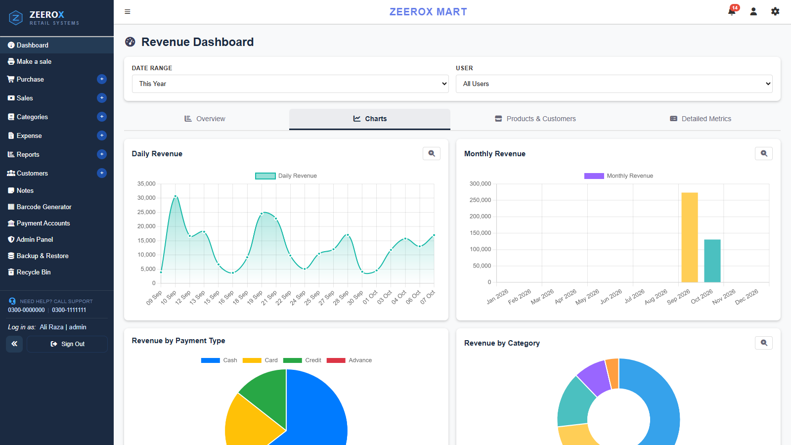

---

## Overview

ZeeroX POS handles the day-to-day work of a shop in one place: billing at the counter, stock and purchases, customer credit and advances, expenses, and the reports an owner needs to understand profit. It runs locally on the shop's own computer (Electron + MySQL), so it works without an internet connection, and it can back up to Google Drive automatically.

## Features

### Sales & Billing
- Fast **POS screen** with product search, keyboard shortcuts (F2 to search) and multiple sale tabs open at once
- **Cash, card, credit and advance** payments, with per-item and per-invoice discount and tax (amount or %)
- **Quotations**, sale editing, and printable receipts in **80mm thermal, A4 and A5** formats with three designs
- **Returns**: full or partial returns against an invoice, plus returns without an invoice

### Inventory & Purchases
- Product, service and medicine purchases with suppliers and categories
- **Stock overview**, low-inventory alerts and expiry tracking
- **Barcode / QR code** sticker generator
- Import and export of purchase lists

### Customers
- Credit customers with due dates, reminders and a complete **account ledger**
- Advance (deposit) customers whose balance is used automatically against future purchases
- Purchase history for each customer

### Reports & Analytics
- **Revenue dashboard**: KPIs, daily and monthly revenue charts, payment-type and category breakdowns, and top products and customers
- **Sales report** comparing the selected period with the previous one
- **Financial report**: profit and loss statement, ratios and receivables aging
- **Purchase report** and expense tracking

### Administration
- Multiple users with **role-based page access**, shift times and performance tracking
- Activity log and notifications for important actions
- Recycle bin for deleted records
- **Backup & restore**, with scheduled Google Drive backups through rclone
- Receipt, currency and default tax and discount settings
- Account recovery through security questions

## Screenshots

| Login | Revenue Dashboard |
|:---:|:---:|
| 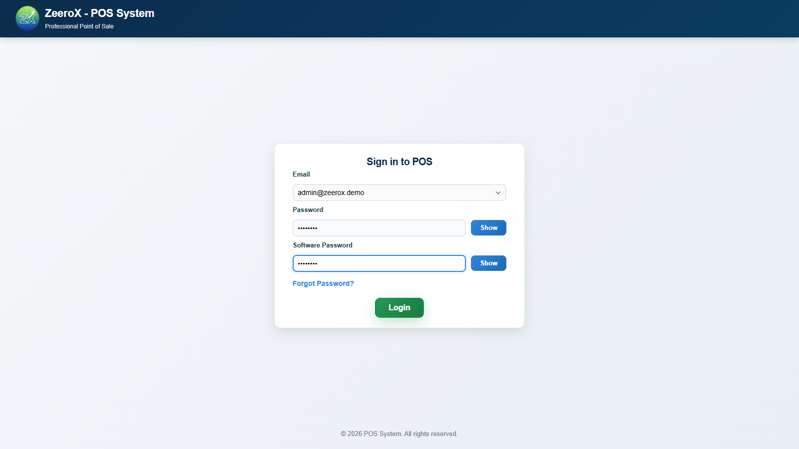 | 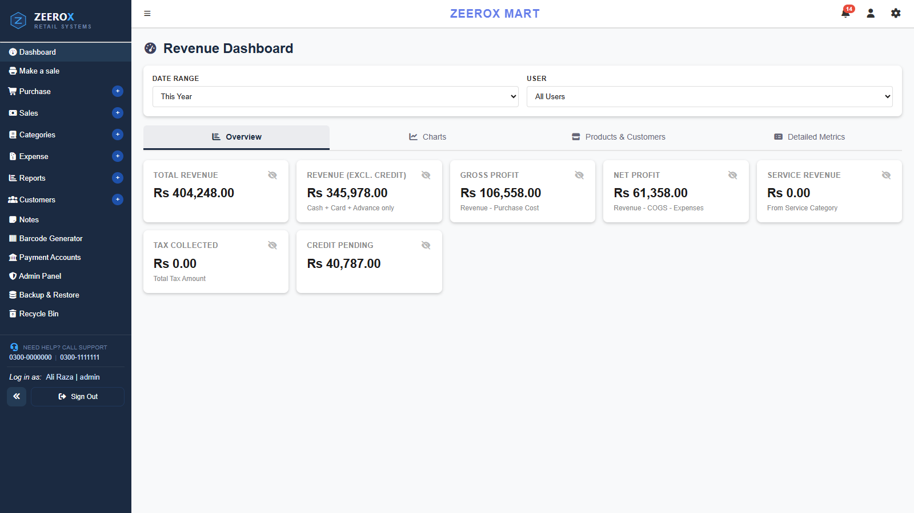 |
| **Point of Sale** | **Top Products & Customers** |
| 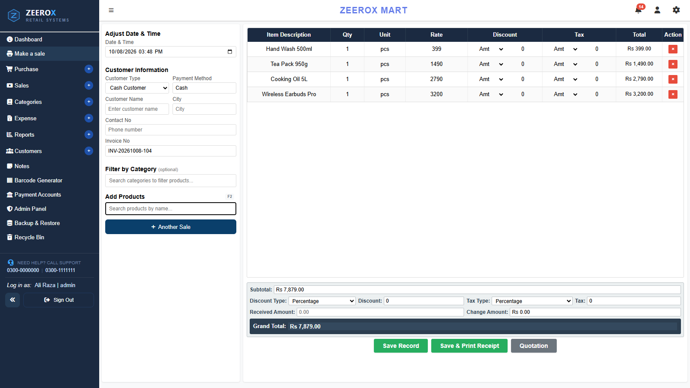 | 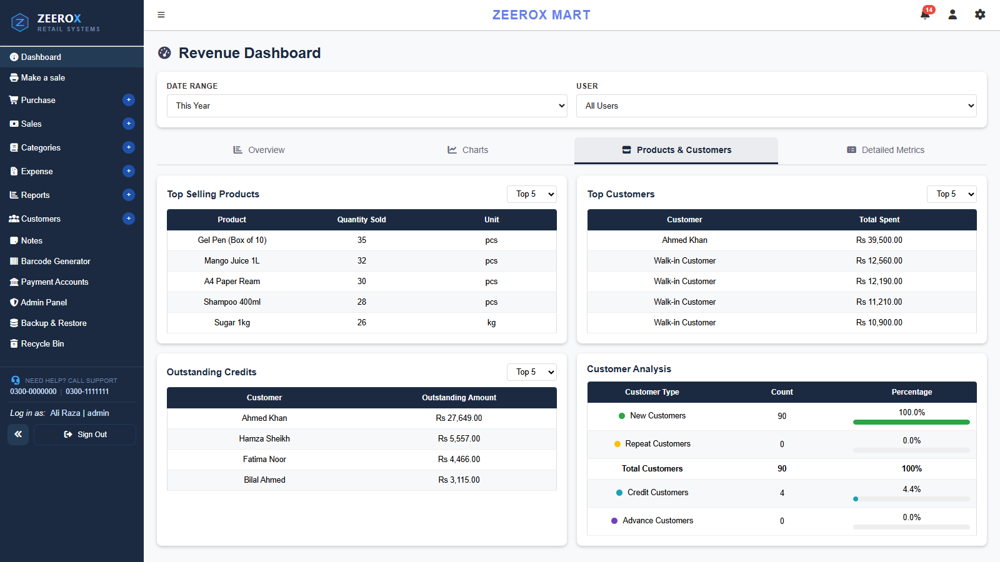 |
| **Daily Sales** | **Stock Overview** |
| 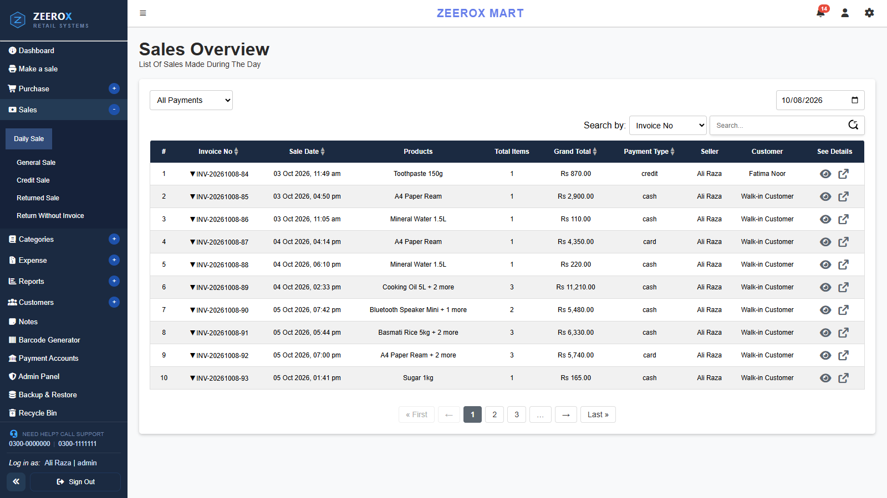 | 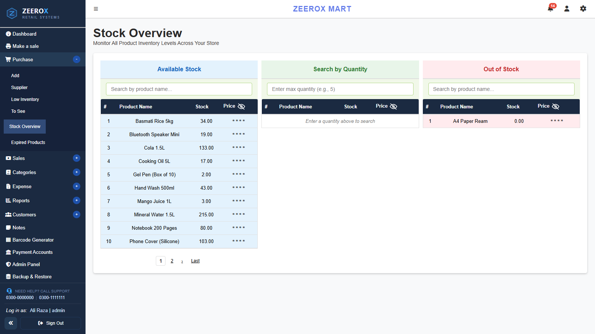 |
| **Products in Store** | **Credit Customers** |
| 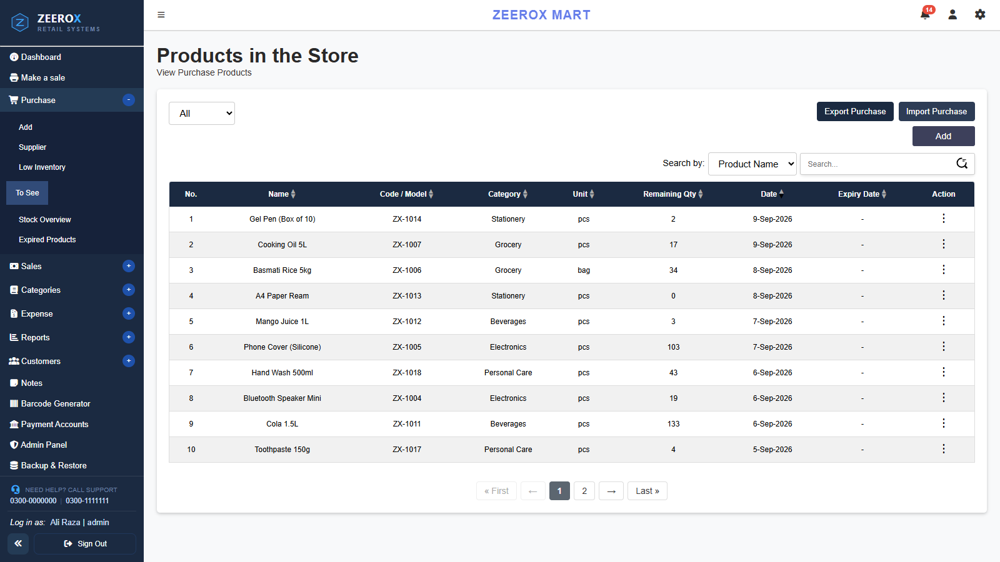 | 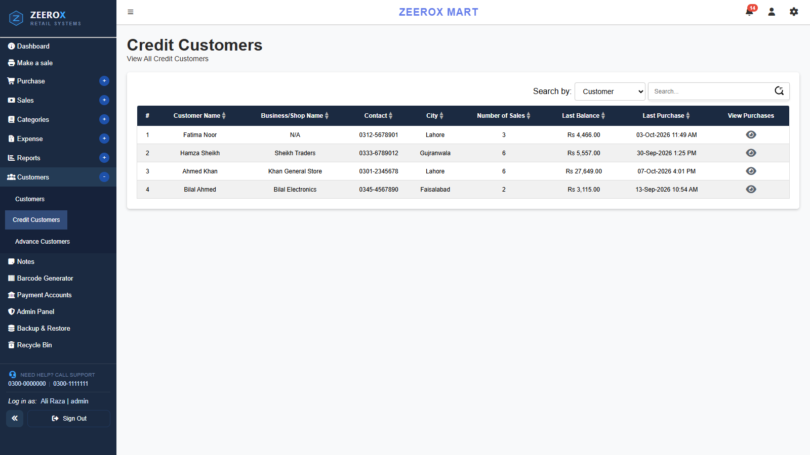 |
| **Sales Report** | **Financial Report** |
| 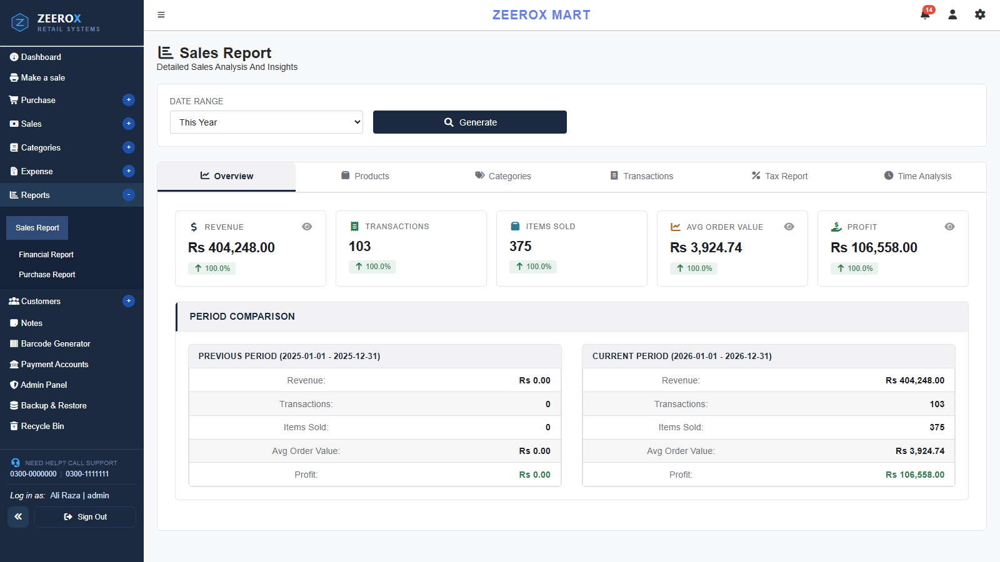 | 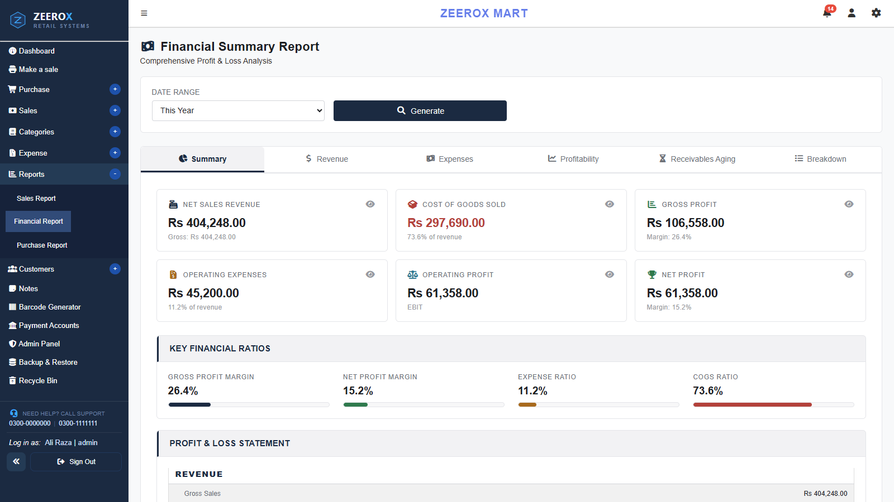 |
| **Receipt Settings** | |
| 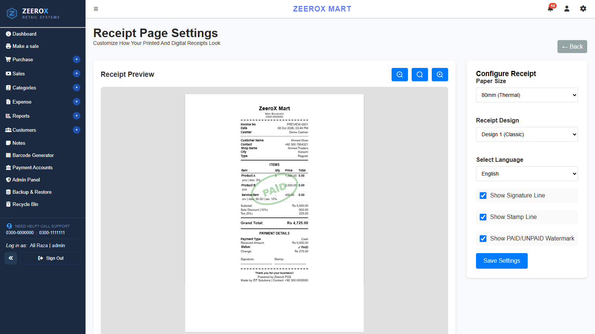 | |

> Screenshots use fictional demo data.

## Tech Stack

| Layer | Technology |
|---|---|
| Frontend | Next.js 16 (App Router), React 19, Chart.js, SweetAlert2, Font Awesome, Lucide |
| Backend | Node.js, Fastify 5, mysql2, bcrypt, node-cron, Nodemailer, Puppeteer (PDF) |
| Database | MySQL / MariaDB |
| Desktop | Electron, electron-builder (NSIS installer) |
| Backups | rclone → Google Drive |

## Project Structure

```
zeerox/
├── backend/           # Fastify REST API
│   ├── middleware/    # auth & license checks
│   ├── routes/        # sales, purchases, customers, reports, ...
│   └── server.js
├── frontend/          # Next.js app (src/app/*)
├── electron/          # Desktop wrapper, installer script, backup scripts
├── database/
│   └── schema.sql     # Full database schema
└── docs/screenshots/
```

## Getting Started

### Prerequisites
- Node.js 20+
- MySQL 8 or MariaDB 10.4+

### 1. Database
```bash
mysql -u root -p < database/schema.sql
```

### 2. Backend
```bash
cd backend
cp .env.example .env                          # fill in your database and SMTP settings
npm install
npm run dev                                   # http://localhost:4000
```

### 3. Frontend
```bash
cd frontend
npm install
npm run dev                                   # http://localhost:3000
```

Open `http://localhost:3000`. On first run, the app takes you through license activation, shop setup and creation of the admin account.

> **Note:** The licensing module (`backend/config/license.js` and `backend/routes/license.js`) is private and is not included in this repository.

### 4. Desktop build (optional)
```bash
cd frontend && npm run build
cd ../electron
npm install
npm run build                                 # installer is written to electron/dist
```
> The installer bundles `node.exe` and `rclone.exe` from `electron/tools/`. They are not in this repository, so download them and place them there before building.

## Author

**Zohaib Amjad** — [@ahmadbajwa9932-netizen](https://github.com/ahmadbajwa9932-netizen)

## License

This is proprietary software. The source is published for portfolio and reference purposes only. All rights reserved.
